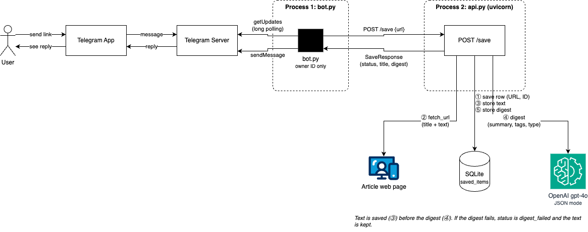

# Read-Later Assistant

Send a link to a private Telegram bot. It saves the article, fetches the text,
and replies with an LLM digest: a short summary, 3 to 5 tags and a content type.

- Single owner: the bot only accepts messages from one Telegram user ID.
- Every save is idempotent: the same URL always gets the same `item_id`.
- Failures are visible: a dead link or a bad model reply returns a clear
  `status` and `error`, and fetched text is never lost.

Milestone notes and test evidence: [docs/milestones/M0.md](docs/milestones/M0.md)

## Setup

1. Python 3.12+ virtual environment:
   `python3.12 -m venv .venv && source .venv/bin/activate`
2. `pip install -r requirements.txt`
3. Copy `.env.example` to `.env` and fill in:
   - `OPENAI_API_KEY`, `OPENAI_MODEL` (we use `gpt-4o`)
   - `TELEGRAM_BOT_TOKEN` (from @BotFather, `/newbot`)
   - `ACCEPT_BOT_FROM_ID` (your Telegram user ID: send the bot any message,
     then read `message.from.id` from `getUpdates`)
   - optional `READLATER_DB` (default `data/readlater.db`)
4. Terminal 1: `uvicorn api:app --app-dir src --reload`
5. Terminal 2: `python src/bot.py`
6. Send a link to the bot. Expected reply: `Saved: <title>`, summary and tags.

Offline tests: `pytest` (no network, no API key needed).

## Flow



## Example Request
### digested
```bash
curl --location 'http://localhost:8000/save' \
-H 'Content-Type: application/json' \
--data '{
    "url": "https://time.com/article/2026/10/01/take-charge-of-my-heart-ending-explained"
}'
```

```json
{
    "item_id": "af4bdf3132b2fdee",
    "url": "https://time.com/article/2026/10/01/take-charge-of-my-heart-ending-explained",
    "status": "digested",
    "digest": {
        "summary": "The series 'Take Charge of My Heart' explores the unconventional romance between a scriptwriter, Bo-bae, who can electrocute anyone she touches, and Ho-rang, a chaebol heir with a failing artificial heart that Bo-bae can recharge. Their relationship, initially a practical arrangement, deepens into love despite family conflicts and threats to their wellbeing, with a resolution that sees them united and Bo-bae's powers dormant.",
        "tags": [
            "k-drama",
            "romance",
            "supernatural",
            "netflix",
            "love story"
        ],
        "content_type": "article"
    },
    "title": "Breaking Down the Ending of 'Take Charge of My Heart'",
    "error": null
}
```

### fetch_failed
```bash
curl --location 'http://localhost:8000/save' \
-H 'Content-Type: application/json' \
--data '{
    "url": "https://html.spec.whatwg.org/"
}'
```

```json
{
    "item_id": "b5a18269beb28b35",
    "url": "https://html.spec.whatwg.org/",
    "status": "fetch_failed",
    "digest": null,
    "title": null,
    "error": "too_large: more than 2000000 bytes"
}
```
### digest_failed
```bash
curl --location 'http://localhost:8000/save' \
-H 'Content-Type: application/json' \
--data '{
    "url": "https://martinfowler.com/articles/microservices.html"
}'
```

```json
{
    "item_id": "87183b91a8a6ddf2",
    "url": "https://martinfowler.com/articles/microservices.html",
    "status": "digest_failed",
    "digest": null,
    "title": "Microservices",
    "error": "invalid_json"
}
```
Captured on 2026-10-17 before the JSON-mode fix.

## Model Choice

- Model: `gpt-4o` through the OpenAI Responses API, with JSON mode on
  (`text.format = json_object`).
- Why JSON mode: on 5 fixed articles (2026-10-12), prompt-only returned valid
  digests for 2/5; the other 3 wrapped the JSON in a markdown code block.
  JSON mode returned 5/5 valid digests.
- Evidence:
  - [JSON mode, 5/5 valid](eval/results/2026-10-12_gpt-4o_json-mode.json)
  - [Prompt only, 2/5 valid](eval/results/2026-10-12_gpt-4o_prompt-only.json)
- Every model reply is still checked by a Pydantic schema; a bad reply becomes
  `digest_failed` instead of a crash.

## Known Failure
1. Medium-hosted blog returns 403
2. Pages over 2 MB are rejected (too_large).
3. Digest retry only happens when the same URL is sent again; there is no retry limit.
4. The bot keeps the Telegram offset in memory only. After a crash, the last message may be processed twice; this is safe because /save is idempotent.

---

Full list: [Known failures and limits](docs/milestones/M0.md#known-failures-and-limits)
