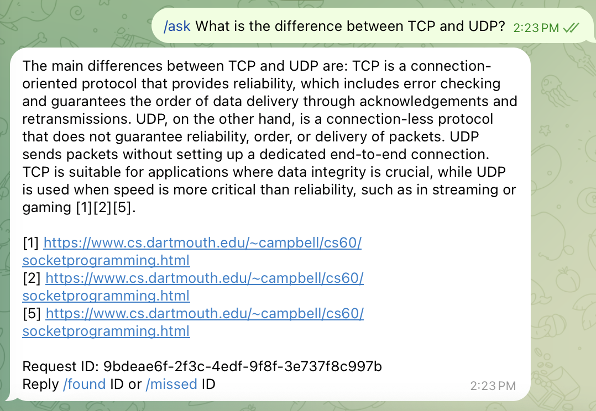
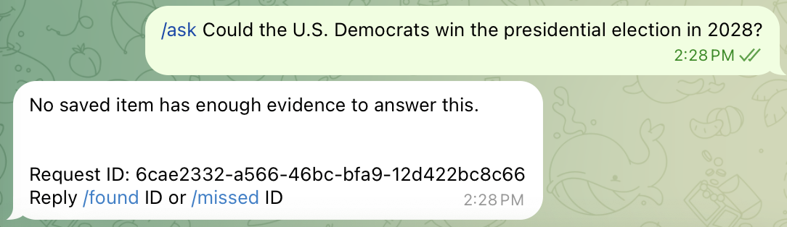

# M1 | Find, Ask and real self-use

Status on 2026-11-01: 5 of 6 checks pass; the self-use check has started but
the sample is still small (see "Usage so far"). Find and Ask work end to end
through the private Telegram bot, with source links and a controlled
"not enough evidence" answer.

## How it works

```
Telegram app -> bot.py --POST /save-->  api.py -> SQLite (saved_items, snapshots)
                       --POST /ask --->        -> chunks (recursive_1000_50)
                       --POST /feedback->      -> Chroma (cosine, persistent)
                                               -> OpenAI (JSON mode, answer + used_refs)
                                               -> SQLite (request_events)
```

- `retrieve(query, k, filters)` searches Chroma with optional `domain` and
  saved-date (`since` / `until`) filters.
- `answer()` refuses in two layers:
  1. **Retrieval layer:** top distance > 0.6 -> refuse, no model call.
  2. **Model layer:** the model returns an empty `used_refs` -> refuse.
- Sources (item ID, link, excerpt, chunk ID) come from the retrieval results,
  not from the model. The model only returns reference numbers.
- `request_events` stores request ID, query length, latency, refusal flag,
  top item IDs and feedback. It does **not** store the query text.

## Acceptance checks

| # | Check | Result | Evidence |
|---|-------|--------|----------|
| 1 | Import 100 links with honest counts; ≥ 50 indexed; no duplicate chunks on re-ingestion | ✅ 75 indexed | below |
| 2 | 20 labeled baseline questions with expected/retrieved IDs, answer, latency, outcome | ✅ 19/20 | `eval/baseline.jsonl`, `eval/results/2026-11-01_baseline.jsonl` |
| 3 | 3 answers checked by hand; 5 no-evidence fixtures refuse | ✅ 3/3, 5/5 | `eval/results/2026-10-26_no_evidence_max_distance_0.6.jsonl` |
| 4 | Date/domain filters never return out-of-filter items; imported dates labeled | ✅ | `tests/test_filter.py`, baseline q11–q15 |
| 5 | Restart and rebuild the index from stored snapshots; same queries still run | ✅ 2115 chunks | below |
| 6 | Real saves/lookups through the bot; request events + found/missed feedback | 🟡 started | below |

### 1. Import (100 personal links, run on 2026-10-19)

| Outcome | Count |
|---------|------:|
| Attempted | 100 |
| Fetched | 75 (digested 73 + digest_failed 2) |
| Failed | 25 |
| **Indexed (has chunks)** | **75** |

Failures by reason: `http_403` × 8, `too_little_text` × 7, `http_404` × 5,
`network_error` × 3, `http_429` × 1, `http_500` × 1.

Retry on 2026-11-01 of the 5 transient failures (network/429/500): 0 recovered.

| URL | First error | 11/1 result |
|-----|-------------|-------------|
| javatpoint.com/dbms-boyce-codd-normal-form | network_error | link no longer valid |
| vegibit.com/node-js-blog-tutorial/ | http_500 | link no longer valid |
| dongxiaoran.com/algo/basic/intro/ | network_error | link no longer valid |
| blog.csdn.net/fuxuemingzhu/article/details/101900729 | network_error | blocked by a human check |
| hashicorp.com/resources/adopting-hashicorp-vault | http_429 | opens in a browser, still blocked for the script |

Re-ingestion: re-chunking unchanged snapshots creates no duplicate chunks
(10/22: 112 chunks twice for 5 items; 10/24: three full rebuilds, 2115 each).
Chunk IDs are based on item ID, strategy, chunk index and chunk text, and
inserted with `INSERT OR IGNORE`.

### 2. 20-question baseline

4 types × 5 questions: vague memory (q01–q05), factual Ask (q06–q10),
date/domain filters (q11–q15), no evidence (q16–q20).

| Run | Result | Notes |
|-----|--------|-------|
| 2026-10-31 | 20/20 | first full run |
| 2026-11-01 | 19/20 | after rebuilding the index; q05 failed (see "Real failures") |

A question passes when every expected item ID is cited, the answer is not a
refusal, and the supporting passage is found in a cited excerpt (whitespace
removed). A no-evidence question passes when it refuses.

### 3. Hand check and no-evidence fixtures

- 3/3 answers checked sentence by sentence against their excerpts
  (TCP/UDP, Vault, DNS). No made-up claims. Small over-generalizations:
  - Vault: describes the transit engine's features as Vault in general.
  - DNS: "vice versa" and "domain name management" are not stated directly.
  - TCP/UDP: "data integrity" and "speed over reliability" are summaries.
- 5/5 no-evidence fixtures refuse. 4 at the retrieval layer, 1 (QUIC,
  distance 0.585) at the model layer.

### 4. Filters and dates

- Filter tests in `tests/test_filter.py` check that no result is outside the
  domain or date range.
- Baseline q15 is the key case: the answer exists in the library, but outside
  the filter. Expected and actual result: refuse.
- Dates: live saves use the save time; the 100 imported links are labeled as
  import time (`saved_day = 20261020`), not a guessed original date.

### 5. Rebuild from scratch (2026-11-01)

1. `mv data/chroma data/chroma_backup_1031`
2. `python src/index.py` (from the repo root) -> **2115 chunks**, same as 10/24.
3. `python src/run_baseline.py` -> 19/20.
4. q05's top distance was **0.5278218984603882** on both 10/31 and 11/1, so
   retrieval results are identical after the rebuild.

### 6. Demo through the bot (2026-11-01)

| Question | Result | Latency | Feedback |
|----------|--------|--------:|----------|
| What is the difference between TCP and UDP? | answered, cites cs.dartmouth.edu | 2969 ms | FOUND |
| What does Vault's transit engine do? | answered, cites learn.hashicorp.com | 2092 ms | FOUND |
| What's DNS? | answered, cites en.wikipedia.org | 2266 ms | FOUND |
| Could the U.S. Democrats win the presidential election in 2028? | refused at retrieval layer | 450 ms | — |

The refusal is ~5× faster because it never calls the model.
Screenshots in `docs/milestones/m1/`:

| Answered with sources | Refused (no evidence) |
|---|---|
|  |  |

Others: [Vault](m1/ask_hashicorp_vault.png), [DNS](m1/ask_dns.png),
[request_events](m1/request_events.png)

## Usage so far

From `request_events` on 2026-11-01:

| Total | FOUND | MISSED | No feedback | Refused | Avg latency |
|------:|------:|-------:|------------:|--------:|------------:|
| 9 | 7 | 0 | 2 | 1 | 2543 ms |

Measurement gaps:
- All 9 requests are tests or the demo, not real lookups. Real use starts in Sprint 2.
- FOUND/MISSED is self-reported, and the demo questions were ones I already
  knew the answers to, so 0 MISSED is optimistic.
- FOUND means "the right article was in the sources", not "the answer is
  fully correct".
- `/opened ITEM_ID` is not built yet, so there is no data on whether I
  actually read the article afterwards.
- Real-use notes go to `eval/field-notes.md`.

## Real failures

### 2026-11-01: model returned `{}` and the whole baseline run crashed

- **What happened:** in JSON mode the model returned `{}`.
  `LLMAnswer.model_validate_json` raised `ValidationError`, the runner
  stopped, and no results were saved.
- **Why:** JSON mode only promises valid JSON, not the fields we need.
- **Fix:** `answer()` retries once; if the second response is still invalid,
  it returns a refusal with `layer = "model_error"` instead of crashing.
  Add a test `test_answer_with_retry` to cover this case.
- **Lesson:** one bad model response should fail one question, not the
  whole run. The same bug would have made `/ask` return 500.

### 2026-11-01: q05 refused even though the answer was in the context

- **Question:** "There's an ariticle about the IOC using Factory design pattern."
  (vague memory, expected item `40a58d732367e4eb`).
- **10/31:** passed, but the model already said "no specific article focuses
  on this" and cited only [4].
- **11/1:** same retrieval results (distance 0.5278), but the model returned
  an empty `used_refs` -> model-layer refusal -> `citation_not_found`.
- **Why:**
  - A "find the article" question goes through the Ask flow. The model is
    asked to answer, so it judges whether there is "an article about X"
    instead of pointing at the closest one.
  - `temperature` is not set, so the same input can give different results.
- **Trade-off:** the model layer catches "looks similar but is not there"
  (QUIC), and can also refuse a question that is answerable (q05).

### Fetch blocks hide articles I want

- Two Vault articles I actually wanted are not in the index: one on Medium
  (`http_403`) and one on hashicorp.com (`http_429`).
- Kept as failure cases; see the "paste text when fetch fails" idea on the
  project page. Decision waits for more data in `eval/field-notes.md`.

## Known limitations

- Vague Find questions are unstable (q05). One baseline run is not enough;
  some questions may pass or fail between runs.
- The 0.6 threshold was chosen from 15 questions (10/26) and passed the
  20-question baseline, but vague questions are close to the edge.
- The same article can appear several times in sources (e.g. [1][2][5] are all
  the same Dartmouth page).
- Citations are grouped at the end of the paragraph, not after each sentence.
- Excerpts are the full ~1000-character chunk and can include noise.
- `saved_day` uses UTC; all 100 imported links share the import date
  (20261020), so date filters only help for live saves.
- Snapshot backfill failed for 1 item (bithacks); its text and chunks exist.

## Next (not in M1)

- Find questions: return the top articles from retrieval directly, without
  asking the model to choose.
- Run each baseline question several times and report a pass rate.
- Merge sources by article; cite after each sentence; shorter excerpts.
- `/opened ITEM_ID`.
- `gpt-4o` retires on 2027-01-14: switch models only after the baseline passes
  with the new one.
